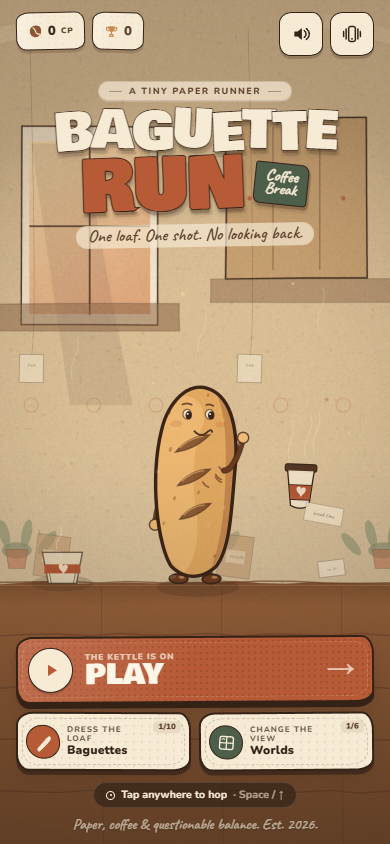
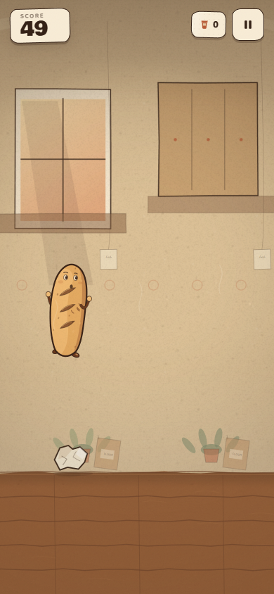
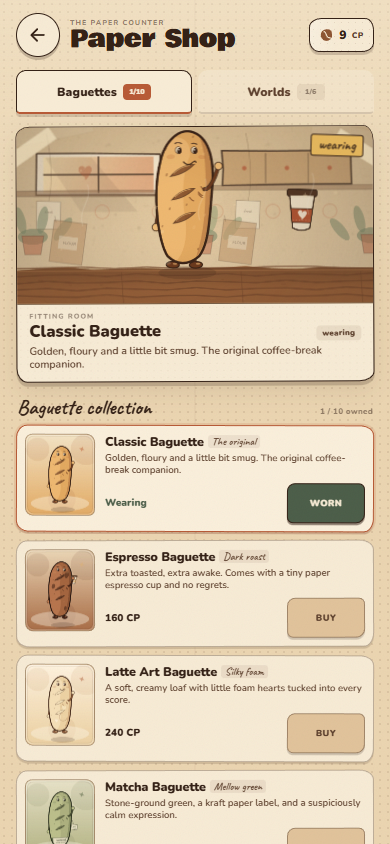

# BAGUETTE RUN: Coffee Break

**Play online:** <https://slazyart.github.io/baguette-run-coffee-break/>

A complete, mobile-first endless runner about a paper baguette, a lot of cardboard
and a very small cup of coffee. Everything is rendered procedurally with Canvas 2D,
CSS and local fonts — there are no CDN requests or runtime asset downloads.

| Menu | In the run | Paper Shop |
| --- | --- | --- |
|  |  |  |

## Run it

Requirements: Node.js 20 or newer and npm.

```bash
npm install
npm run dev
```

Open the local URL printed by Vite (by default <http://127.0.0.1:5173>).

Production build and local preview:

```bash
npm run build
npm run preview
```

The compiled, self-contained game is written to `dist/`.

## Controls

- **Touch:** tap anywhere, or swipe upward, to jump. Holding a finger down never
  causes repeated jumps.
- **Keyboard:** `Space`, `↑` or `W` to jump.
- **Pause:** tap the pause button, press `P`, or press `Escape`. The game also
  pauses itself when the tab loses visibility or is blurred.
- **Shop:** Baguettes and Worlds are separate tabs. Tap a card to preview it;
  only the action button spends Coffee Points.

The browser back gesture and pull-to-refresh are suppressed while playing. The shop
and overlays use their own vertical touch scrolling.

## What is included

- An endless runner with a fixed-step physics loop, forgiving hitboxes, a safe
  opening interval, gradual speed/difficulty ramp and pooled obstacles.
- Six obstacle families: crumpled napkins, sugar packets, empty takeaway cups,
  giant coffee beans, cardboard boxes and kraft bag stacks.
- Rare coffee-cup collectibles with a pickup hop, paper particles, a happy baguette
  reaction, a HUD pop and an extra score/CP bonus.
- A run score built from distance plus a small cup bonus.
- A permanent Coffee Points wallet with exactly-once run rewards. A finished run
  is claimed against its unique run id, including after a retry spam-click.
- 10 cosmetic baguette skins and 6 hand-built worlds, with animated fitting-room
  previews and live re-equipping.
- A versioned, defensive `localStorage` save. Corrupt or incompatible saves fall
  back to a clean, valid state instead of breaking the app.
- Procedural paper textures, hand-drawn outlines, tape, fibres, cut-paper shadows,
  parallax sets, and a coffee-paper sound kit synthesized with Web Audio.
- Responsive portrait layout with safe-area support, DPR-aware canvas scaling,
  touch-action isolation, reduced-motion support and ARIA labels.
- A single reusable `requestAnimationFrame` loop. No duplicate loops on retry,
  no per-frame localStorage writes, and all decorative resources are lazy/cached.

## Project map

```
src/
  App.ts                    screen orchestration, lifecycle, resize, pause
  main.ts                   boot
  styles.css                handmade paper UI + responsive layout
  core/
    AudioManager.ts         Web Audio effects
    InputManager.ts         pointer/keyboard jump input
    SaveManager.ts          versioned save, single transaction path
    SkinManager.ts          equipped cosmetic lookup
    types.ts                shared data contracts
  data/
    skins.ts                all baguette cosmetics
    worlds.ts               all world palettes and copy
  game/
    GameLoop.ts             fixed-step rAF loop
    Physics.ts              hitboxes, collision, tuning constants
    Player.ts               jump/run pickup state
    ObstacleSpawner.ts      pooled procedural hazards and fair gaps
    Collectibles.ts         pooled rare coffee cups
    Particles.ts            pooled paper confetti and pickup ghost
    ScoreSystem.ts          distance + cup bonus
    CurrencySystem.ts       once-only run reward conversion
    Shop.ts                 catalog-facing purchase facade
    RunnerGame.ts           run simulation and save hand-off
  render/
    Renderer.ts             scene composition
    BackgroundManager.ts    cached paper sets, parallax, six worlds
    CharacterRenderer.ts    drawn baguette, skins, idle/run/jump/death poses
    Props.ts                obstacles, cups, cached hazard sprites
    TextureFactory.ts       procedural paper grain and fibres
    DrawUtils.ts            hand-drawn paper primitives
  ui/
    UIController.ts         screens, shop, results, toasts, settings
    ShopPreview.ts          animated fitting room
```

## Tuning

Most gameplay balance lives in a few deliberately small places:

- `src/game/Physics.ts` — gravity, jump velocity, hitbox insets.
- `src/game/RunnerGame.ts` — start/max speed, scoring cadence, collision order.
- `src/game/ObstacleSpawner.ts` — obstacle tiers, gaps and combo chance.
- `src/game/Collectibles.ts` — cup interval and height bands.
- `src/game/CurrencySystem.ts` — CP formula (`1 CP / 8 m + 2 CP / cup`).
- `src/data/skins.ts` and `src/data/worlds.ts` — names and CP prices.

The prices are tuned for quick repeat runs: a competent 45–60 second run earns
roughly 100–150 CP, so early cosmetics are reachable in a few attempts.

## Save data

Key: `baguette-run.coffee-break.save`

The save stores CP, best score, run/cup totals, owned and equipped skins/worlds,
sound and haptics preferences, and the last claimed run id. To reset progress
during development, remove that key from `localStorage` and reload.

## Static deployment

`npm run build` produces a static `dist/` directory and nothing else is needed.
`vite.config.ts` uses `base: './'`, so the build also works from a subdirectory.

Examples:

- **Netlify / Vercel / Cloudflare Pages:** build command `npm run build`, output
  directory `dist`.
- **GitHub Pages:** the live build for this repository is at
  <https://slazyart.github.io/baguette-run-coffee-break/>. The Pages source is
  **GitHub Actions**, and the included `.github/workflows/deploy-pages.yml`
  workflow builds and publishes the game on every push to `main` (and can also be
  run manually from the Actions tab). No `gh-pages` branch is needed.
- **Any web server:** copy `dist/` to the document root or a subfolder.

The workflow has the correct Pages permissions and deploys the `dist` artifact
through the official `actions/deploy-pages` action. The Vite `base: './'` setting
means the game also works when the repository is served from
`username.github.io/repository/`.

No server-side code, database, account or payment provider is involved.

## Local fonts and licences

The game ships WOFF2 files locally for **Bowlby One**, **Caveat** and **Nunito**
(all SIL Open Font License) in `src/assets/fonts/`. They are only downloaded during
development from Google Fonts; the built game serves them from `dist/assets/`.

---

Made with paper, coffee and questionable balance.
